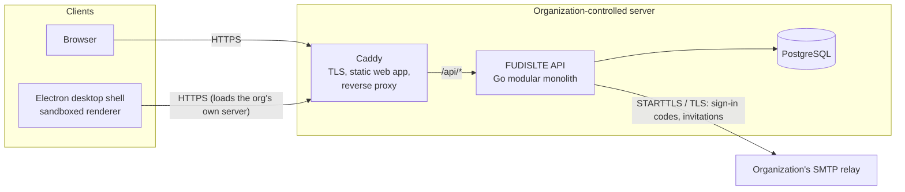
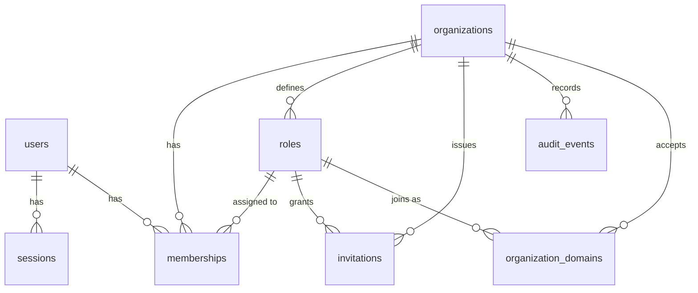

# Phase 1 Architecture — Foundation

Status: **Implemented** (see "Verification" at the end for what was actually tested).

Phase 1 delivers the smallest foundation every later module builds on: a self-hostable
Go API with PostgreSQL, secure authentication, organizations with role-based
permissions, a React application shared by the browser and desktop clients, and a
hardened Electron shell. Nothing in Phase 1 depends on a third-party cloud service.

## 1. Scope

| In Phase 1                                                     | Deferred (phase)                              |
| -------------------------------------------------------------- | --------------------------------------------- |
| First-run setup: setup token + email confirmation code         | SSO / OIDC / SAML (10)                        |
| **Passwordless sign-in with one-time email codes** (ADR-0006)  | HTML emails (2)                               |
| Server-side sessions, session list and revocation, sign-out    | Admin-initiated account disable (1.x)         |
| Organizations (workspaces), workspace switcher                 | Teams and departments (2)                     |
| Nine default roles, custom roles, permission catalog           | Per-resource permissions: channels, rooms (2–3) |
| Emailed invitations; acceptance confirmed by email code        | Presence and status (2, via Centrifugo)       |
| Company email domains with automatic joining                   | Domain ownership verification via DNS (2)     |
| Member management with role hierarchy rules                    | Messaging, files, voice, tasks (2+)           |
| Role-grouped member sidebar                                    | Redis-backed rate limiting for multi-node (2) |
| Organization audit log                                         | Instance-wide admin console (2)               |
| Light / dark / system theme; mockup-based design (ADR-0007)    | Auto-update and code signing pipeline (10)    |
| Turkish and English UI, API errors and emails, per user        | More languages (on demand)                    |
| Docker Compose deployment files (Caddy + API + PostgreSQL)     | LiveKit, coturn, Centrifugo, object storage (2–4) |

The navigation shows only features that exist. Later modules register their own
navigation entries; there are no disabled placeholder buttons.

## 2. System view



Target architecture for later phases (not built yet) adds, behind the same proxy:
Centrifugo (real-time fan-out, Phase 2), self-hosted object storage (Phase 2),
LiveKit + coturn (Phase 4) and an optional, isolated AI worker (Phase 8). The Go API
remains the only component that makes authorization decisions and writes business data.

### Why the desktop app loads the organization's server

The desktop shell is a thin, hardened container around the same web application the
browser uses. On first launch the user enters their organization's server address; the
shell then loads that origin in a sandboxed renderer. Consequences:

- One frontend, one session model (HttpOnly cookie), no CORS, no tokens in JS.
- Client and server versions never drift: the UI always matches the server it talks to.
- Desktop-only abilities (open external links, change server, later: screen-source
  picker, notifications, badge counts) are exposed through a small, validated preload
  bridge described by `packages/platform`.

See [ADR-0003](../decisions/0003-desktop-shell-loads-org-server.md).

## 3. Repository layout

```
apps/
  web/            React + Vite application (browser and desktop renderer)
  desktop/        Electron main + preload + local "connect to server" page
services/
  api/            Go modular monolith (cmd/, internal/<module>/)
packages/
  ui/             Design tokens (CSS variables) and shadcn-style components
  api-client/     Typed HTTP client and API DTO types
  platform/       Web/desktop capability abstraction + desktop bridge contract
infrastructure/
  docker/         Compose files, Caddyfile, API Dockerfile
docs/             Architecture, decisions, security, deployment
scripts/          Development helpers (WSL backend runner, database bootstrap)
```

Adaptation from the master plan: `shared-types` is folded into `api-client` (the shared
types *are* the API contract) and `design-tokens` lives in `packages/ui/src/styles`.
They can be split out when a second consumer appears.

## 4. Backend modules (`services/api/internal`)

| Package    | Responsibility                                                                 |
| ---------- | ------------------------------------------------------------------------------ |
| `config`   | Environment configuration with validation                                      |
| `database` | pgx pool, transactions, embedded goose migrations                              |
| `httpx`    | JSON encoding, typed API errors, client IP resolution, rate limiter, middleware |
| `auth`     | Accounts, one-time email codes, session tokens, logout, sessions, profile      |
| `mail`     | SMTP (STARTTLS / TLS) and development log senders, background outbox, templates |
| `login`    | Email-code sign-in: request a code, verify it, domain-based account creation    |
| `org`      | Organizations, roles, permission catalog, memberships, invitations, email domains, `/me` |
| `audit`    | Append-only audit events written in the same transaction as the change         |
| `setup`    | `/meta` and first-run instance setup                                           |
| `server`   | Router wiring and middleware order                                             |

Dependency direction: `server → (setup, login) → org → auth → (audit, mail, database,
httpx)`. `auth` knows nothing about organizations.

## 5. Data model



- **users** — instance-wide identity: normalized work `email` (unique), `display_name`,
  `is_instance_admin`. No password. A user can belong to several organizations.
- **email_codes** — one-time codes (salted SHA-256 only), purpose, attempts, expiry.
- **organization_domains** — `(org_id, domain)` with the role new people join as; the
  same composite foreign key pattern keeps the role inside the organization.
- **sessions** — opaque random token; only its SHA-256 is stored. Absolute and idle
  expiry, explicit revocation.
- **organizations** — tenant boundary. Every tenant-scoped row carries `org_id`.
- **roles** — per-organization, with `position` (authority rank), `permissions text[]`
  and `is_system` (the Owner role is immutable).
- **memberships** — `(org_id, user_id)` primary key, one role per member. The composite
  foreign key `(role_id, org_id) → roles(id, org_id)` makes it impossible, at the
  database level, to assign a role from another organization.
- **invitations** — single-use token (hash stored), expiry, role, revocation.
- **audit_events** — who did what, to what, from where, with JSON metadata.

## 6. Authorization model

Permissions are a fixed catalog defined in Go (`org/permissions.go`):

| Permission       | Grants                                       |
| ---------------- | -------------------------------------------- |
| `org.manage`     | Edit workspace name and settings             |
| `members.view`   | See the member directory and member emails   |
| `members.invite` | Create and revoke invitations                |
| `members.manage` | Change member roles, remove members          |
| `roles.manage`   | Create, edit and delete roles                |
| `audit.view`     | Read the workspace audit log                 |

Rules enforced in the service layer, tested in `org/*_test.go`:

1. Every `/orgs/{orgID}/…` request loads the caller's membership first. Non-members get
   `404` (the workspace's existence is not disclosed); members lacking a permission get `403`.
2. Organization IDs used in queries come from the loaded membership, never the body.
3. A member can only manage members whose role ranks **below** their own, can only
   assign roles ranking below their own, and can only grant permissions they hold.
   Owners are exempt; only owners can assign the Owner role.
4. The last Owner of a workspace can never be demoted or removed.

Casbin was evaluated and deferred; see [ADR-0005](../decisions/0005-relational-rbac.md).

## 7. Authentication and sessions

There are no usernames or passwords ([ADR-0006](../decisions/0006-passwordless-email-codes.md)).

- **Sign-in**: the person enters their work email; FUDISLTE emails an 8-digit code (10
  minutes, single use, 5 attempts); entering it starts a session. The response to a code
  request is identical whether or not the address has an account, and the lookup happens
  after the response.
- **Who can sign in**: existing members, and new people whose email domain a workspace
  registered under *Settings → General → Email domains*. They join with the role chosen
  for that domain and confirm their display name after the first sign-in.
- **Sessions**: 256-bit random token in an `HttpOnly`, `SameSite=Lax` cookie (`Secure` and
  the `__Host-` prefix in production). 30-day absolute lifetime, 7-day idle timeout,
  `last_seen_at` written at most every 5 minutes. People can sign out other devices.
- **CSRF**: Go's `http.CrossOriginProtection` rejects cross-origin state-changing requests
  using `Sec-Fetch-Site` / `Origin`; combined with `SameSite=Lax` cookies.
- **Rate limits** (in-memory token buckets): code requests per address and per IP, code
  verification per IP, setup and invitation endpoints per IP. Multi-node deployments move
  this to Redis/Valkey in Phase 2.
- **Email**: SMTP with STARTTLS or implicit TLS is mandatory in production. Development
  writes emails to the API log (`FUDISLTE_MAIL_TRANSPORT=log`).

### First-run setup

When no user exists, creating the first workspace and its Owner (who also becomes
instance administrator) requires the setup token **and** a code sent to the owner's
email. The token is read from `FUDISLTE_SETUP_TOKEN` or generated at startup and printed to
the API log, so a freshly exposed server cannot be claimed by whoever reaches it first;
the code proves the owner's address and that mail delivery works. Setup runs under a
PostgreSQL advisory lock and can only succeed once.

## 8. HTTP API (v1)

All endpoints are JSON under `/api/v1`. Errors use
`{"error": {"code": "...", "message": "...", "fields": {...}}}`.

| Method & path                                   | Auth                    |
| ----------------------------------------------- | ----------------------- |
| `GET /meta`                                     | public                  |
| `POST /setup/code`, `POST /setup`               | setup token (+ email code) |
| `POST /auth/code`, `POST /auth/verify`          | public (email code)     |
| `POST /auth/logout`                             | session                 |
| `GET /invitations/{token}`, `POST …/code`       | public (token)          |
| `POST /invitations/{token}/accept`              | token + email code, or session of the invited address |
| `GET /me`, `PATCH /me`                          | session                 |
| `GET /me/sessions`, `DELETE /me/sessions[/{id}]`| session                 |
| `GET /permissions`                              | session                 |
| `POST /orgs`                                    | instance administrator  |
| `GET /orgs/{id}` · `PATCH /orgs/{id}`           | member · `org.manage`   |
| `GET /orgs/{id}/members`                        | `members.view`          |
| `PATCH/DELETE /orgs/{id}/members/{userId}`      | `members.manage` + hierarchy |
| `GET /orgs/{id}/roles`                          | member                  |
| `POST/PATCH/DELETE /orgs/{id}/roles[/{roleId}]` | `roles.manage` + hierarchy |
| `GET/POST/DELETE /orgs/{id}/invitations[/{id}]` | `members.invite`        |
| `GET/POST/DELETE /orgs/{id}/domains[/{domain}]` | `org.manage` (+ role hierarchy) |
| `GET /orgs/{id}/audit-events`                   | `audit.view`            |

Health: `GET /healthz` (process) and `GET /readyz` (database reachable).

## 9. Frontend structure

- `apps/web/src/app` — router, providers, auth gate.
- `apps/web/src/features/<feature>` — one folder per feature (auth, setup, workspace,
  members, settings). Each owns its routes, queries and components.
- `apps/web/src/shell` — application frame: left sidebar (workspace switcher, primary
  navigation, user menu), centre outlet, collapsible right member panel grouped by role.
- Server state: TanStack Query. Client state: React state; Zustand is introduced only
  when cross-tree client state appears (voice connection in Phase 4).
- The platform layer (`@fudislte/platform`) is the only code that knows whether it runs in
  a browser or the desktop shell.

Screens in Phase 1: Setup (token + email → code + workspace) · Sign in (email → code →
name for new people) · Accept invitation (name → code) · Home · Settings → Profile,
Security (sessions), General & email domains, Members & invitations, Roles, Audit log.

## 10. Desktop shell security

`contextIsolation`, `sandbox` (globally via `app.enableSandbox()`), `nodeIntegration`
off, `webSecurity` on, `webviewTag` off. Navigation is restricted to the configured
server origin and the bundled `fudislte://app` pages; everything else opens in the system
browser after a scheme check (`https:` / `http:` / `mailto:` only). New windows are
denied. Permission requests are denied except an explicit allow-list for the server
origin. IPC handlers validate the sender frame's origin and every argument. The bundled
connect page is served from a custom protocol with a strict CSP instead of `file://`.
Packaged builds flip Electron fuses (no `RunAsNode`, no `NODE_OPTIONS`, no inspector
flags, ASAR integrity, cookie encryption).

Screen sharing (Phase 4) will use `session.setDisplayMediaRequestHandler` with a FUDISLTE
source picker — Chromium inside Electron supports `getDisplayMedia` on Windows, macOS
(screen-recording permission) and Linux (PipeWire on Wayland).

## 11. Development environment

- Frontend and desktop run on the host with Node 24 and pnpm.
- The Go API and PostgreSQL run on Linux — in development under WSL2 on Windows (which
  avoids Windows Smart App Control blocking freshly compiled binaries), in production
  on the server via Docker Compose.
- Vite proxies `/api` to the API on `localhost:8080`, so the browser and the desktop shell
  both see a single origin exactly like production.

See the repository README for commands.

## 12. Verification

Last run: 2026-10-30, on Windows 11 with the API and PostgreSQL 17 in WSL2.

| Check | Result |
| --- | --- |
| `pnpm check:api` — gofmt, `go vet`, Go tests | 50 tests pass: 21 HTTP integration tests against real PostgreSQL (setup with code, code sign-in, single use and 5-attempt limit, no code for unknown addresses, per-address rate limit, CSRF, invitations with codes, domain auto-join, cross-workspace isolation, role hierarchy, custom roles, errors in the `Accept-Language` language, saved language used for email, last activity shown only to managers) plus unit tests for config, i18n catalog, mail (including SMTP against a fake server with STARTTLS), codes, Argon2id, HTTP helpers |
| `scripts/wsl/build-api.sh` | Static Linux binary builds; `fudislte-api healthcheck` passes against a running API |
| `pnpm typecheck` | All 5 TypeScript packages pass (includes the check that English defines every Turkish UI string) |
| `pnpm test` | 21 Vitest tests pass (API client, platform, desktop security policy, web helpers) |
| `pnpm --filter @fudislte/web build` | Production build succeeds |
| `pnpm --filter @fudislte/desktop smoke` | Electron 45 loads the web app sandboxed: bridge exposes exactly 5 functions, no `require`/`process`, bridge IPC answers the server origin, foreign navigation blocked |
| Browser walkthrough | Setup, invitation, role-grouped member panel, role change, audit log (password era); then email-code sign-in, domain registration (gmail.com rejected), first sign-in from a company domain with automatic join as Employee |
| Redesign screenshots (1440×900, headless Edge) | Sign-in, home, users table, roles, account settings and command palette match the mockups (docs/design); dark mode; switching to English in *My account* changes the UI, API errors and email language |
| Docker (Engine in WSL) | `scripts/wsl/docker-local.sh up` builds the API and web images and serves the stack on http://localhost:8088; containers report healthy |

Not yet verified: real SMTP delivery to an inbox (development uses the log transport; the
SMTP client is tested against a fake server), the production Compose stack with a real
domain and TLS certificate, the desktop "connect to server" screen with a remote HTTPS
server, and desktop packaging.
